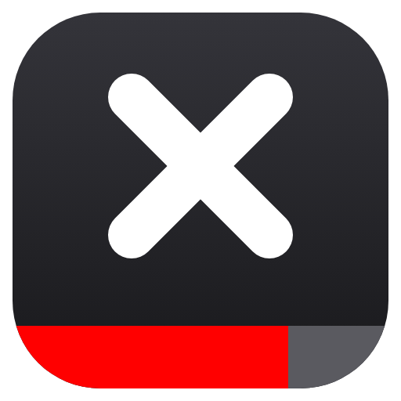
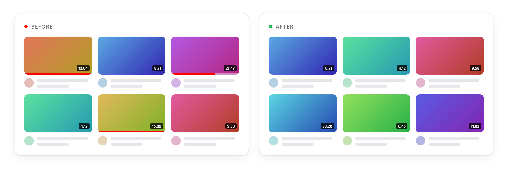
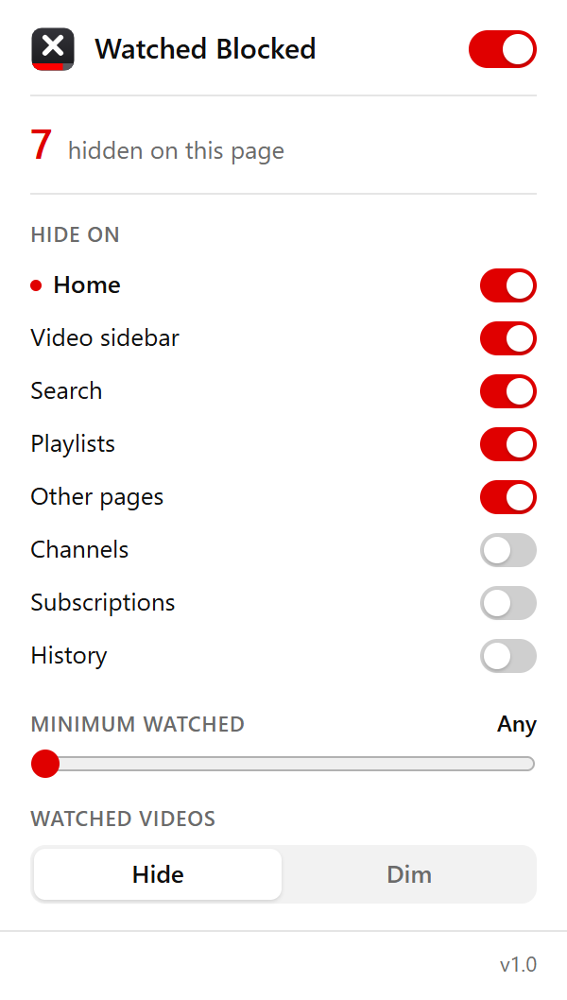

<p align="center">
  
</p>

<h1 align="center">Watched Blocked</h1>

<p align="center">Hide videos you've already watched on YouTube.</p>

<p align="center">
  
  
  
  
</p>

<p align="center">
  <picture>
    <source media="(prefers-color-scheme: dark)" srcset="assets/hero-dark.png">
    
  </picture>
</p>

YouTube keeps showing you videos you've already seen. Watched Blocked hides them from your home page, the sidebar, search and playlists. Channel pages, your Subscriptions feed and History stay as they are, so you can still see everything a creator has posted.

## Where it works

| Page | Default |
| --- | :---: |
| Home | On |
| Sidebar next to a video | On |
| Search results | On |
| Playlists and the playlist queue | On |
| Trending, Gaming and topic pages | On |
| Channel pages | Off |
| Subscriptions | Off |
| History | Off |

## Settings



Click the toolbar icon to open the settings.

**On/off.** Turn it off everywhere, or only on the pages you pick.

**Minimum watched.** Hide only videos you've watched past a set point. "Any" hides everything you've started. 100% hides only videos you finished.

**Hide or dim.** Dimmed videos fade out and come back when you point at them.

The number on the toolbar icon is how many videos are hidden on the page you're on.

Your settings sync between your devices through your browser's sync.

<kbd>Alt</kbd> + <kbd>Shift</kbd> + <kbd>W</kbd> turns it on and off. If your browser didn't assign the shortcut, set it at `chrome://extensions/shortcuts`.

<br clear="right">

## Install

1. Download this repo (**Code → Download ZIP**) and unzip it.
2. Open `chrome://extensions`. In Brave it's `brave://extensions`, in Edge `edge://extensions`.
3. Turn on **Developer mode**.
4. Click **Load unpacked** and choose the `extension` folder.

## How it works

YouTube draws a red bar under the thumbnail of every video you've watched. Watched Blocked looks for that bar and hides the video. It checks new videos as YouTube loads them, before they appear on screen.

You need to be signed in to YouTube with watch history turned on.

## Privacy

Watched Blocked only runs on youtube.com. It doesn't collect anything, and nothing leaves your browser except your settings, which your browser syncs for you.

<details>
<summary><b>Development</b></summary>

<br>

```bash
npm install
npx playwright install chromium

npm test              # unit and end-to-end tests
npm run package       # build dist/watched-blocked-1.0.zip
npm run icons         # rebuild icons from assets/logo.svg
npm run screenshots   # popup screenshots
npm run assets        # README and store images
```

The end-to-end tests load the extension into a real browser. They run it on YouTube-like test pages and on youtube.com itself. Set `WB_SKIP_LIVE=1` to skip youtube.com.

To run them in Brave or Edge, point `WB_BROWSER` at the browser:

```bash
WB_BROWSER="C:/Program Files/BraveSoftware/Brave-Browser/Application/brave.exe" npm run test:e2e
```

Store listing copy and images are in [`store/`](store).

</details>

## License

[MIT](LICENSE)
